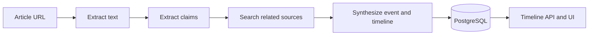

# FactStream

**A prototype for connecting a news claim to evidence and a timeline.**

FactStream accepts an article URL, extracts its text and claims, searches for related evidence, and uses an LLM to organize the result as an event with articles, claims, and timeline entries. A FastAPI service exposes the results to a small browser interface.



## What is here

- Article extraction with a search-provider fallback when the page text is insufficient.
- Claim extraction and event/timeline synthesis using an OpenAI-compatible LLM workflow.
- PostgreSQL models for events, articles, claims and timeline items, with optional vector fields.
- Streaming analysis progress and a browser-based timeline.

## Run locally

Requires Python 3.10+, PostgreSQL with the `vector` extension, and your own OpenAI and Tavily API credentials. The database URL must use SQLAlchemy's `postgresql+asyncpg` dialect.

```bash
python -m venv .venv
source .venv/bin/activate
pip install -r requirements.txt
cp .env.example .env
# Edit .env with your own database URL and API credentials.
uvicorn app.main:app --host 127.0.0.1 --port 8000
```

The source snapshot does not include a migration or database initialization script. Provision the schema from `app/models/` before using analysis endpoints; this step and live provider calls were not exercised as part of the public snapshot's offline smoke test. Once running, `/health` returns a basic health response and `/` serves the UI.

## Project map

| Path | Purpose |
| --- | --- |
| `app/routers/` | Analysis and event endpoints |
| `app/services/` | Scraping, search, LLM extraction and synthesis |
| `app/models/` | Event, article, claim and timeline data model |
| `app/worker/` | Early follow-up discovery implementation |
| `static/` | Browser interface |

## Boundaries

This is a research prototype: generated verdicts and timelines are not independently verified facts. The follow-up worker is a partial implementation, not a complete automated update system. URL query stripping in deduplication can conflate distinct articles. The service fetches user-supplied URLs and has permissive development CORS settings; keep it local until authentication, network restrictions and deployment security have been designed for your environment. API calls can incur costs. No production credentials, database contents or article caches are included.
